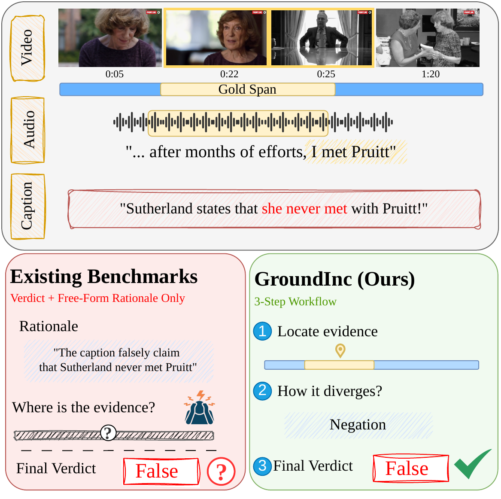

<p align="center">
  
</p>

# GroundInc
[](https://opensource.org/licenses/Apache-2.0)
[](https://www.python.org/)

GroundInc is a benchmark for evidence-grounded video caption verification. The
task has three steps: grounding a caption to the relevant video segment,
classifying the type of inconsistency, and predicting veracity, over 10
inconsistency types across visual and spoken evidence. This repository has the
code and annotations for caption generation, inference, and finetuning.

> **Abstract:** Video caption verification requires more than predicting whether
> a caption is true or false. A fact-checker must also identify the relevant
> evidence in the video and explain how a false caption contradicts that
> evidence. However, existing benchmarks primarily evaluate the final verdict
> without testing whether models can support the intermediate reasoning steps. To
> address this gap, we introduce GroundInc, an evidence-grounded benchmark for
> video caption verification. GroundInc decomposes the task into three sub-tasks
> that mirror the fact-checking workflow: temporally grounding a caption to the
> relevant video segment, classifying the type of inconsistency, and predicting
> caption veracity. The benchmark covers 10 inconsistency types spanning both
> visual and spoken evidence. Evaluating 11 vision-language models, we find that
> inconsistent captions degrade temporal grounding performance and that models
> localize spoken evidence far more reliably than visual evidence. Providing the
> gold evidence as a textual pointer does not improve downstream performance,
> whereas physically restricting the input to the relevant segment does. These
> findings show that high verdict accuracy can mask an inability to ground and
> explain the inconsistency, so verdict-only evaluation overstates how well
> models actually perform video caption verification.

Contact person: [Shivam Sharma](mailto:sharma.shivam2705@gmail.com)

[UKP Lab](https://www.ukp.tu-darmstadt.de/) | [TU Darmstadt](https://www.tu-darmstadt.de/)

Don't hesitate to send us an e-mail or report an issue if something is broken or
if you have further questions.

## Getting Started

```bash
conda create -n groundinc python=3.10 -y
conda activate groundinc
pip install -r requirements.txt
pip install -e .
```

ffmpeg is required for the snippet video modes. For finetuning, also install the training dependency with `pip install -e ".[train]"`.

### Repository layout

- `data/`: the GroundInc annotations.
- `prompts/`: the caption generation prompts.
- `src/groundinc/data_generation/`: caption generation.
- `src/groundinc/evaluation/`: inference runners.
- `src/groundinc/training/`: finetuning data preparation and configs.
- `src/groundinc/data/`: data loading and prompts.
- `docs/`: data format, training, and reproducibility notes.

### Data and media

The repository ships the annotations only. Videos, transcripts, and audio are
not included. The `id` field is a YouTube identifier, and the source videos can
be obtained through ChronusAV. See [`docs/DATA.md`](docs/DATA.md).

## Usage

### Generate captions

```bash
export GEMINI_API_KEY=...
python -m groundinc.data_generation.generate_with_gemini \
  --input_jsonl <input>.jsonl \
  --output_jsonl outputs/generated.jsonl \
  --prompt1_file prompts/step1_prompt.md \
  --prompt2_file prompts/step2_prompt.md \
  --video_dir videos
```

### Run inference

```bash
python -m groundinc.evaluation.vllm_asr \
  --vllm_url http://localhost:8000/v1 \
  --input_file data/groundinc_news.jsonl \
  --output_file outputs/predictions.jsonl \
  --video_mode auto --asr_dir asr \
  --prompt_style temporal_inconsistency_veracity
```

Use `--list_prompt_styles` to see the available styles. `vllm_audio` is the
video and audio version.

| Video mode | Input |
| --- | --- |
| `auto` / `id` / `clip` | Whole video |
| `snippet` | The relevant segment |
| `masked_snippet` | Full video with everything outside the segment masked |
| `predicted_snippet` | The model's predicted segment |

### Finetune

```bash
python -m groundinc.training.prepare_sft \
  --input data/groundinc_other.jsonl \
  --video_dir videos --asr_dir asr \
  --prompt_name inconsistency_no_grounding \
  --output sft/train.json
cp src/groundinc/training/dataset_info.json sft/
llamafactory-cli train src/groundinc/training/configs/qwen3vl_8b_lora.yaml
```

See [`docs/TRAINING.md`](docs/TRAINING.md).

## Disclaimer

> This repository contains experimental software and is released for the sole
> purpose of giving additional background details on the respective publication.
